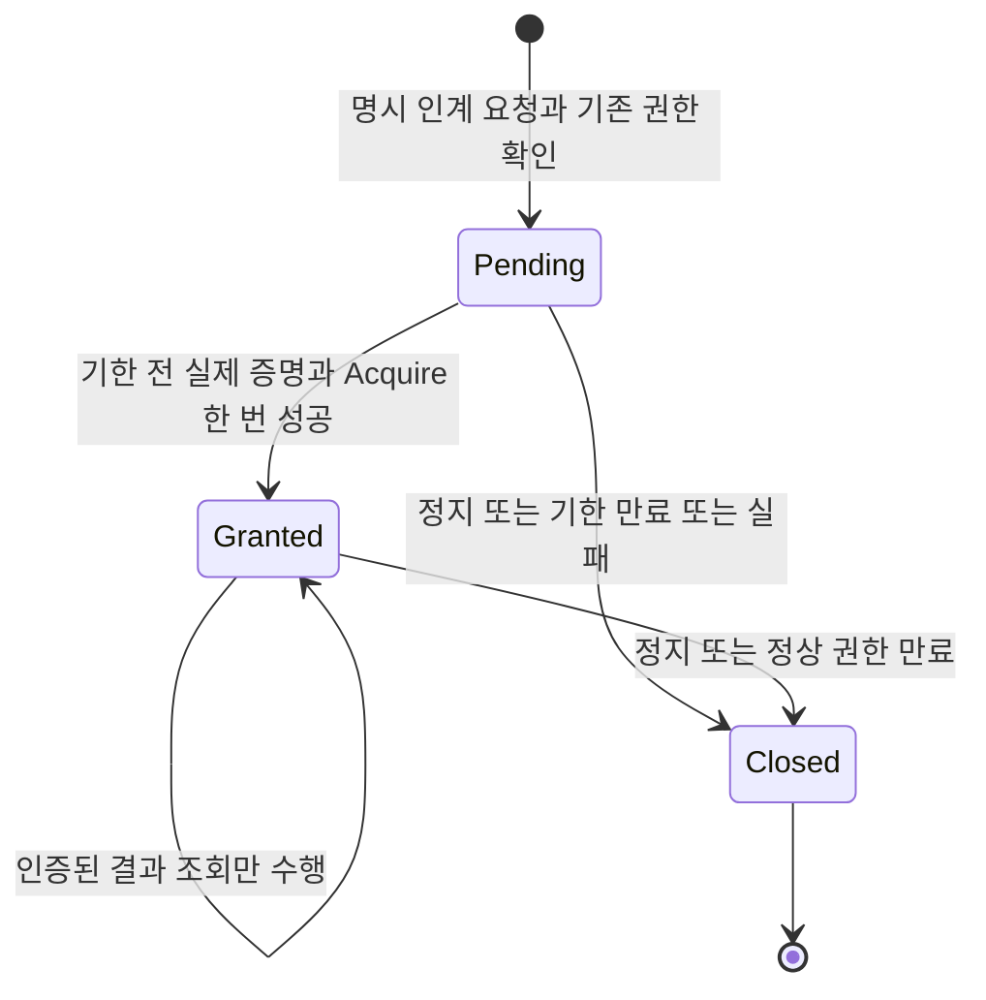

# 인계 시간 조건 — 031 참조 모형

**제품 펌웨어에 아직 연결하지 않은 설계·시험 모형입니다.** 실물 보정 미승인,
링 형상 보류, 기존 030 브라우저 운전 검증 BLOCK은 유지됩니다.

현재 화면은 짧은 Ready 순간을 250ms 조회로 놓칠 수 있습니다. 새 설계에서는
사용자가 ‘인계 후 제어권 받기’를 누를 때 서버에 한 번의 예약을 남깁니다.
서버가 실제 증명과 기존 Gate 허가를 같은 시점에 확인하고, 화면은 그 결과를
나중에 조회합니다. 상태 조회 자체는 제어권이나 이동을 만들지 않습니다.



| 구분 | 시간 조건 |
|---|---|
| 서버에서 권한을 발급할 기한 | 기존 Boot 만료와 접수+700ms 중 빠른 시각 **미만** |
| 성공 후 정상 권한 | 실제 Acquire 성공 시각+800ms, 기존 규칙 |
| 화면 상태 조회 / 갱신 점검 | 기존 250ms / 50ms 유지 |
| 결과 관측의 조건부 최대 지연 | `max(발급, ACK수신)+250+50+49+49ms` |
| 결과를 받은 뒤 다음 명령 여유 | 왕복 지연과 다음 송신까지 최대447ms, 권한800ms 안에서 검증 |
| 클라이언트 관측 정리 상한 | 명시된 지연 가정에서 클릭+1147ms, 서버 발급기한 연장 아님 |

49ms 각 구간과 50ms 화면 지연은 **모형의 가정**이며 실제 Wi-Fi 측정값이 아닙니다.
원래 700ms 서버 기한 안에 증명이 없으면 실패합니다. 그 뒤 결과를 읽을 수 있다는
이유로 발급을 늦추거나 권한을 연장하지 않습니다. 정지·숨김·연결 해제 후의
늦은 응답은 로컬 권한을 복원하지 않습니다. 아직 전달받지 못한 외부 정지는
휴대폰이 안다고 가정하지 않으며, 실제 서버의 정지 상태가 명령을 차단해야 합니다.

이 모형의 `proof`와 `admission_ok`는 입력 oracle입니다. 실제 Run/Gate 호출,
CAN 바이트, 타깃 실행, 물리 정지 또는 숫자 GUI 성공의 증거가 아닙니다.
내부 Acquire가 소비한 sequence floor도 다음 명령에 넘겨야 합니다.

실행(저장소 루트, Python 표준 라이브러리만 사용):

```powershell
py src/control_timing/run.py
```

기존 증거를 덮지 않도록 `author-r1`이 있으면 중단합니다. 개별 시험의 재실행:

```powershell
py src/control_timing/test_contract.py
```

원기록의 6993/7162/7177ms는 관측된 점으로만 사용합니다. 4500개 위상·지연
조합에는 별도로 표시한 합성 증명 구간을 사용합니다. 초기에 빠졌던 조회 송신
49ms 반례와 엄격한 만료 등호, 숨은 연장, 취소 후 복원, 조회의 중복 Acquire를
검사합니다. 실제 제품 연결 후에는 030의 DOM 양성·지연·정지·오프라인·음성 대조
시험을 별도로 통과해야 합니다.
